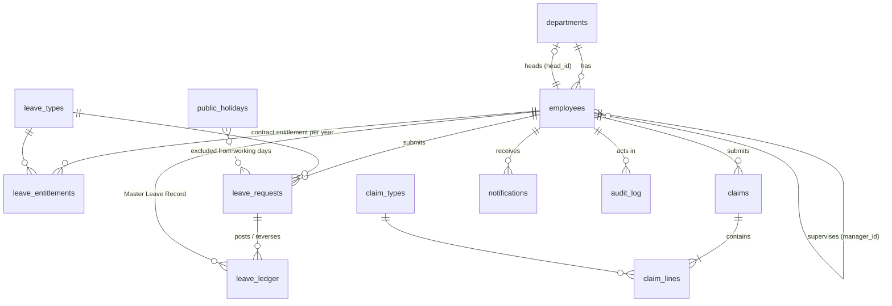

# Workpath: a Workday-style leave & claims portal (Next.js + Supabase)

A Workday-style HR portal built for the **Leave & Claims workflow** from AIA Activities 1.1 and 1.2:

> Employees apply online. The form checks their balance, public holidays and team clashes, then routes the request to the right supervisor or Department Head, with reminders after 1 working day and escalation after 2. Approval is one click. Approved leave posts straight to the **Master Leave Record**, and approved claims go to **Finance's payment queue**. Nothing gets re-keyed, every step is time-stamped, and HR gets a live view.

The app is branded **Workpath** (original name and logo). It follows Workday's layout: Home with apps, an Inbox for approvals, Time Off, Expenses, a Team calendar, and HR and Finance workspaces.

## What it does

| Activity step | Where in the app | How it's enforced |
|---|---|---|
| 1. Capture (type, dates, reason, MC no. / expense lines, receipts) | **Time Off → Request**, **Expenses → Create expense report** | Standard templates for every request, with `LV-` / `CL-` reference numbers |
| 2. Validate (balance, working days excl. weekends & SG public holidays, policy) | Live "Check before you submit" panel | `preview_leave` / `_validate_leave` in Postgres. The same rules run again on submit and on approve |
| 3. Clash check | Panel, Inbox card and Team calendar | Department colleagues with pending or approved leave on the same dates get a **Team clash** flag |
| 4. Approve (one click, remark needed to reject, reminders and escalation) | **Inbox** | Routing: supervisor → Department Head → Director → HR. No one can approve their own request. `pg_cron` runs hourly: a reminder after 1 working day, escalation after 2 |
| 5a. Record leave | **HR → Master Leave Record** | Approval writes a ledger posting in the same transaction. Balance = entitlement − approved days ± HR adjustments |
| 5b. Claim → Finance | **Finance** | Approval sets the status to *Submitted to Finance*. Finance pays it (payment ref required) or returns it (remark required) |
| 6. Notify | Bell icon and **Notifications** | Employee, approver, Office Manager, HR and Finance are notified at each step |
| 7. Report | **HR → Overview & monthly report** | Breakdowns by type and department, sick-leave patterns, and the success-criteria KPIs. CSV exports for payroll |

### Rules ported from the activity tests (each blocked with a clear message)
Overlapping dates · over balance · leave spanning two years · sick leave without an MC · unpaid leave while annual leave remains · a holiday-only day · a claim line without a receipt · no declaration · reject without a remark · pay without a payment ref · self-approval · wrong approver · duplicate receipt · annual leave in the past.
**Flags** (shown to the approver, never block): Short notice · Team clash · Over limit · Late submission.
**Pro-rating:** someone who joins in July 2026 gets 7 of 14 AL days. **Sick leave** counts toward the 60-day hospitalisation cap.

## Tech
- **Next.js 16** (App Router, Server Actions, `proxy.ts` session refresh), React 19, Tailwind CSS v4
- **Supabase**: Postgres, Auth (email + password), Row Level Security, Storage (private `receipts` bucket), `pg_cron`
- All business rules live in **Postgres functions**, so the UI can't bypass them and every write is atomic

## Database schema



| Table | Purpose |
|---|---|
| `departments` | Department, and its head (`head_id`) |
| `employees` | Staff record linked to `auth.users`. `roles` is any of `employee, manager, hr, office_manager, finance, director, admin`. `manager_id` is the approver |
| `public_holidays` | Singapore MOM gazetted holidays for 2026–2027, including days in lieu |
| `leave_types` | Policy per type: default days, MC required, back-dating, notice, `counts_toward` (SL→HL cap), `requires_exhausted` (UL after AL) |
| `leave_entitlements` | Contract entitlement per employee, type and year (pro-rated for joiners) |
| `leave_requests` | The request: working days, flags, clash snapshot, balance before/after, approver, original approver, decision, reminder and escalation timestamps |
| `leave_ledger` | **Master Leave Record** postings: `approved` (−days), `reversal` (+days on cancellation), `adjustment` (HR, with a note) |
| `claim_types` | Expense categories with per-line guideline limits and whether a receipt is required |
| `claims`, `claim_lines` | Claims Register: status `pending → submitted_to_finance → paid / returned` (or `rejected`, `cancelled`), with payment ref and date |
| `notifications` | In-app notifications |
| `audit_log` | Time-stamped trail of every submit, decision, posting, reminder, escalation and payment |
| `v_leave_balances` (view) | Entitlement, taken, adjustments, pending, balance and available, per employee, type and year |

**Key RPCs** (callable by signed-in users, and each one checks the caller's role):
`preview_leave`, `submit_leave_request`, `decide_leave_request`, `cancel_leave_request`, `preview_claim`, `submit_claim`, `decide_claim`, `cancel_claim`, `finance_pay_claim`, `finance_return_claim`, `team_absence`, `hr_leave_report`, `hr_set_entitlement`, `hr_adjust_balance`, `hr_generate_entitlements`, `hr_create_login`, `run_reminders_now`.
Internal `_functions` take an explicit actor and are not callable from the API.

**RLS summary**: each person sees their own records. Supervisors and Department Heads see their team. HR, the Office Manager and Directors see everything. Finance sees all claims. The team calendar returns only dates and types, never reasons or MC numbers. There is no direct write access to requests, claims or the ledger: those writes go through the RPCs only.

Migrations are in [`supabase/migrations`](supabase/migrations), and the demo data is in [`supabase/seed.sql`](supabase/seed.sql).

## Demo accounts
Every account uses the password `Workpath2026!`. Change these or remove them before real use.

| Who | Email | What to try |
|---|---|---|
| Daniel Lee, Operations | daniel.lee@example.com | Request leave (AL 10/14 left) and see the live balance and clash panel. Submit a claim |
| Marcus Tan, Head of Ops | marcus.tan@example.com | Inbox: Siti's request carries a **Team clash** flag. Approve or reject |
| Sarah Koh, Head of Sales | sarah.koh@example.com | Inbox: a short-notice half day and an over-limit dinner claim |
| Grace Lim, MD | grace.lim@example.com | Marcus's own leave was routed to her |
| Nur Aisyah, HR | aisyah@example.com | Master Leave Record, monthly report, staff, sign-ins, holidays |
| Rachel Ong, Office Manager | rachel.ong@example.com | Notified on every approval. Read-only HR view |
| Mei Ling Wong, Finance | meiling.wong@example.com | Payment queue: pay with `PAYROLL-2026-11` or return |
| Priya Nair, July 2026 joiner | priya.nair@example.com | Pro-rated AL: 3 of 7 left |

## Run locally
```bash
cp .env.example .env.local     # URL and publishable key for the Supabase project
npm install
npm run dev                    # http://localhost:3000
```

## Deploy to Vercel
1. Import `yifangoh/workday-clone` in Vercel. Framework: Next.js. No build settings to change.
2. Add these environment variables (Production and Preview):
   - `NEXT_PUBLIC_SUPABASE_URL` = `https://mkfjxtgwuvpmwqmddjwd.supabase.co`
   - `NEXT_PUBLIC_SUPABASE_PUBLISHABLE_KEY` = the publishable key from Supabase → Settings → API Keys (`NEXT_PUBLIC_SUPABASE_ANON_KEY` also works)
3. Deploy. Region `sin1` (Singapore) is set in `vercel.json` to sit next to the database (`ap-southeast-1`).
4. In Supabase → Authentication → URL Configuration, set the **Site URL** to your Vercel domain.

No service-role key is needed. HR creates sign-ins in the app (**HR → Staff**). An Auth user invited from the Supabase dashboard with the same email as an employee record is linked automatically.

### Setting up a fresh Supabase project
Run the files in `supabase/migrations` in order, then `supabase/seed.sql`, using the SQL editor or `supabase db push`. The seed creates the demo users, and the sample requests go through the real workflow functions.

## Before going live
- Replace the default entitlements and claim limits with your contract and finance-policy figures (**HR → Staff, entitlements & holidays**).
- Delete the demo users, or change their passwords. Turn on leaked-password protection in Supabase Auth.
- Email or Teams delivery of notifications isn't wired up yet. The `notifications` table is the hook: add a Database Webhook or Edge Function to send through Resend or Teams.
